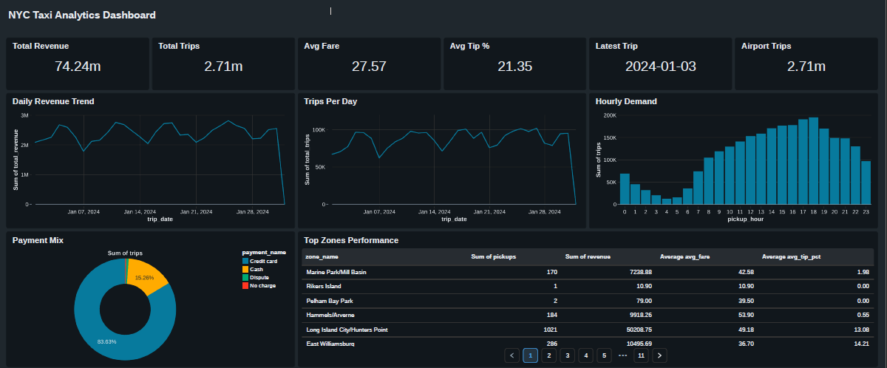

<div align="center">

# 🚕 NYC Taxi End-to-End Data Engineering Lakehouse Pipeline

**A production-grade Lakehouse pipeline on Databricks using the Medallion Architecture (Bronze ➜ Silver ➜ Gold)**


</div>

---

## 📌 Overview

This project ingests **NYC Yellow Taxi trip data**, applies robust **schema enforcement**, handles **SCD Type 2 dimension tracking**, runs **data quality validation checks**, and builds **aggregated analytical data marts** that power a business dashboard.

### ✨ Key Highlights

- 🏅 **Medallion Architecture**: clean separation of raw, cleaned, and business-ready data
- 🗂️ **Unity Catalog** for governance, naming, and access control
- 🔄 **SCD Type 2** to keep full history of changing dimension records
- ✅ **Automated Data Quality Checks** to catch bad records early
- ⚡ **Delta Lake optimization** (OPTIMIZE, Z-ORDER, VACUUM)
- 🚀 **CI/CD** with GitHub Actions
- 📊 **Analytics dashboard** built on the Gold layer

---

## 🏗️ Architecture

```text
 ┌──────────────────────────┐
 │  Raw Parquet Source Data │
 └────────────┬─────────────┘
              ▼
 ┌──────────────────────────────────────────────────────────┐
 │ 🥉 BRONZE  →  Ingestion & Storage (Raw Delta Tables)      │
 └────────────┬─────────────────────────────────────────────┘
              ▼
 ┌──────────────────────────────────────────────────────────┐
 │ 🥈 SILVER  →  Cleansing, Schema Enforcement,              │
 │               SCD Type 2 Dimensions & Fact Tables         │
 └────────────┬─────────────────────────────────────────────┘
              ▼
 ┌──────────────────────────────────────────────────────────┐
 │ 🥇 GOLD    →  Aggregated Data Marts (Business-Ready)      │
 └────────────┬─────────────────────────────────────────────┘
              ▼
 ┌──────────────────────────┐
 │  📊 Analytics Dashboard  │
 └──────────────────────────┘

   Unity Catalog governs all layers (Bronze / Silver / Gold)
```

| Layer | Purpose |
|-------|---------|
| 🥉 **Bronze** | Ingestion and storage of raw data as Delta tables in Unity Catalog |
| 🥈 **Silver** | Data cleansing, schema enforcement, SCD Type 2 dimensions, and fact tables |
| 🥇 **Gold** | Aggregated, business-ready marts for analytics and dashboards |

---

## 📊 Dashboard

> Interactive analytics dashboard built on top of the Gold layer.

<p align="center">
  
</p>

📂 Dashboard files: [`dashboard/`](./dashboard) &nbsp;|&nbsp; 📑 Full POC document: [`POC/NYC_Taxi_Lakehouse_POC.pdf`](./POC/NYC_Taxi_Lakehouse_POC.pdf)

---

## 🛠️ Tech Stack

| Category | Tools |
|----------|-------|
| **Platform** | Databricks |
| **Processing** | PySpark |
| **Storage Format** | Delta Lake |
| **Governance** | Unity Catalog |
| **Orchestration** | Databricks Workflows |
| **CI/CD** | GitHub Actions |
| **Language** | Python, SQL |

---

## 📁 Project Structure

```
NYC-taxi-project/
├── .github/workflows/
│   └── ci-cd.yaml                  # CI/CD pipeline
├── POC/
│   └── NYC_Taxi_Lakehouse_POC.pdf  # Proof of concept document
├── dashboard/                      # Analytics dashboard + preview image
├── data/
│   ├── taxi_zone_lookup.csv
│   ├── taxi_zone_lookup_v2.csv     # Updated zones (used for SCD2 demo)
│   └── yellow_tripdata_2024-01.parquet
├── notebooks/
│   ├── 01_config.py
│   ├── 02_setup_unity_catalog.py
│   ├── 03_bronze_layer.ipynb
│   ├── 04_silver_layer.ipynb
│   ├── 05_dimensions_scd2.py
│   ├── 06_fact_trips.py
│   ├── 07_gold_marts.py
│   ├── 08_data_quality_checks.py
│   └── 09_optimize_and_maintenance.py
├── workflows/
│   └── workflow-config.json        # Databricks workflow definition
└── README.md
```

---

## 🔄 Pipeline Walkthrough

| # | Notebook | What it does |
|---|----------|--------------|
| 1 | `01_config.py` | Central configuration: catalog, schema, paths, and parameters |
| 2 | `02_setup_unity_catalog.py` | Creates catalog, schemas, and tables in Unity Catalog |
| 3 | `03_bronze_layer.ipynb` | Ingests raw Parquet data into Bronze Delta tables |
| 4 | `04_silver_layer.ipynb` | Cleans data and enforces schema |
| 5 | `05_dimensions_scd2.py` | Builds dimension tables with **SCD Type 2** history tracking |
| 6 | `06_fact_trips.py` | Builds the trips fact table linked to dimensions |
| 7 | `07_gold_marts.py` | Creates aggregated Gold data marts for reporting |
| 8 | `08_data_quality_checks.py` | Runs validation rules on the data |
| 9 | `09_optimize_and_maintenance.py` | Runs OPTIMIZE, Z-ORDER, and VACUUM on Delta tables |

---

## 🔁 SCD Type 2 Explained

When a dimension record changes (for example a taxi zone update), the old row is **closed** and a new row is **inserted**, so history is never lost.

| zone_id | zone_name | start_date | end_date | is_current |
|---------|-----------|------------|----------|------------|
| 1 | Old Name | 2024-01-01 | 2024-06-01 | false |
| 1 | New Name | 2024-06-01 | NULL | true |

---

## ✅ Data Quality Checks

- Null checks on critical columns
- Valid pickup/dropoff timestamps (dropoff after pickup)
- Non-negative fare, distance, and passenger counts
- Referential integrity between fact and dimension tables
- Duplicate detection

---

## 🚀 Getting Started

### Prerequisites
- A Databricks workspace with **Unity Catalog** enabled
- A cluster or serverless compute with PySpark and Delta Lake support

### Steps

```bash
# 1. Clone the repository
git clone https://github.com/Avani-Sharma/NYC-taxi-project.git

# 2. Import the notebooks/ folder into your Databricks workspace
#    (Repos > Add Repo, or upload manually)

# 3. Upload the data files from data/ to your Volume or DBFS

# 4. Update paths and names in notebooks/01_config.py

# 5. Run the notebooks in order (01 to 09) or deploy workflows/workflow-config.json
```

---

## ⚙️ CI/CD

The GitHub Actions workflow in `.github/workflows/ci-cd.yaml` automates validation and deployment of the pipeline whenever changes are pushed to `main`.

---

## 🔮 Future Improvements

- [ ] Incremental ingestion with Auto Loader
- [ ] Streaming ingestion for real-time trips
- [ ] ML model for fare or demand prediction
- [ ] Alerting on data quality failures

---

## 👩‍💻 Author

**Avani Sharma**

[](https://github.com/Avani-Sharma)

---

<div align="center">

⭐ If you found this project useful, please consider giving it a star!

---

© 2026 **Avani Sharma**. All Rights Reserved.

This project is created for learning and portfolio purposes.
Unauthorized copying or redistribution of this work without credit to the author is not permitted.

</div>
